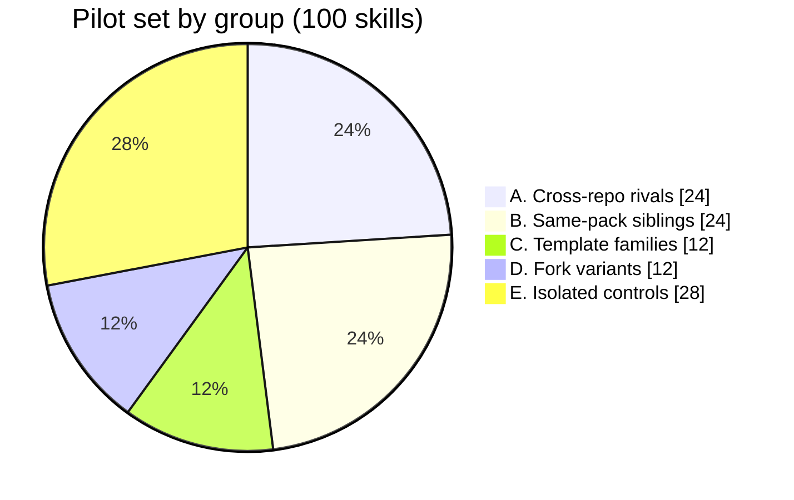

# MSR_Challenge_Gitskills_Brooks_Ash

MSR 2027 Mining Challenge project on the [GitSkills dataset](https://huggingface.co/datasets/mvaccargiu/gitskills) (3.8M `SKILL.md` files from 282K public GitHub repositories).

**Research question:** to what extent can similar agent skills confuse a coding agent into picking the wrong skill?

## Phase 1: grouping similar skills

Phase 1 finds skills that are textually similar and organizes a 100-skill pilot set into groups by *type of confusion*. It is a feasibility pilot. Nothing here has been run on an agent yet, and the selection has not been hand-validated.

### Pipeline

1. **Filter.** Stream the `artifacts` config with DuckDB, keeping `dedup_primary=1`, valid front matter, and a description of at least 20 characters. This leaves **1,617,013 usable skills** from 221,961 repos.
2. **Sample.** Take 100K English skills, with at most 20 per repo and exact-duplicate descriptions removed (a few registry repos hold 10-27K skills each).
3. **Tokenize and compare.** TF-IDF over `name + description` (word 1-2 grams, English stopwords, sublinear tf), then top-10 cosine neighbours per skill.
4. **Group.** Pick skills into five groups with the rules below.

Median top-1 similarity is 0.28 and the 99th percentile is 0.91, where the highest-scoring pairs are near-copies.

### The 100-skill pilot set

| Group | Skills | What it tests |
|---|---|---|
| A. Cross-repo rivals | 24 (6 clusters of 4) | Different repos and names, same job (similarity 0.33-0.75) |
| B. Same-pack siblings | 24 (6 x 4) | Adjacent skills in one repo that would be installed together |
| C. Template families | 12 (3 x 4) | Shared boilerplate descriptions, only the topic differs |
| D. Fork variants | 12 (3 x 4) | Same skill copied across repos with small edits (control: any copy counts as correct) |
| E. Isolated controls | 28 (7 x 4) | Random, unrelated skills (baseline error rate) |

The 100 skills come from 73 repos.

### Findings so far

- **Forks look like rivals.** In the 0.55-0.8 similarity band most cross-repo pairs share a name and are near-identical, so they are copies of one skill, not competitors. They are excluded from group A and kept as the group D control.
- **Real rivals score lower.** Pairs such as `decompose-plan` and `create-plan` score about 0.41, so the rival threshold has to be low.
- **Junk to filter.** Auto-generated `cluster-N` skills, security-test fixtures, and very short descriptions.

### Known limitations

- Lexical similarity misses paraphrase rivals with different wording. An embedding recall check is planned but not done.
- Some clusters are weak (A3 fine-tuning tools is loose, C3 shares only "Use when you..."), and group B shows the sibling pattern but little real confusion.
- Cross-repo similarity only matters if the skills are installed together, so confusion tests need controlled skill sets.
- 24 of the 100 skills have no license listed. Check `repos.license` before redistributing text.

### Reproducing

- `data/selected100.csv`: the 100 selected skills (group, repo, path, name, stars, license, description, file_sha).
- `scripts/step1_filter.py <out.parquet>`: stream-filter usable skills from the Hugging Face parquet.
- `scripts/step2_neighbors.py`: sample 100K and compute TF-IDF neighbours.
- `scripts/step3_select.py`: build the five groups and write the selection.

The scripts read and write under `data/` relative to the working directory and need `duckdb`, `pandas`, `pyarrow` and `scikit-learn`. Step 1 writes `skills_clean.parquet`, which step 2 expects at `data/skills_clean.parquet`. Descriptions in the CSV come from public repositories and stay under each repo's license.

## Next steps

1. Hand-review the 100 skills and swap out weak clusters.
2. Spike: run `codex exec --json` on a few toy skills to confirm which skill Codex loaded can be read from its output. Codex is used as the agent under test to avoid bias from developing the pipeline with Claude.
3. Write a golden set (user request, correct skill, acceptable alternatives) per cluster, drafted by more than one model and spot-checked by a human.
4. Run Codex over the sets, score skill choice, and use an LLM judge only for borderline items.
